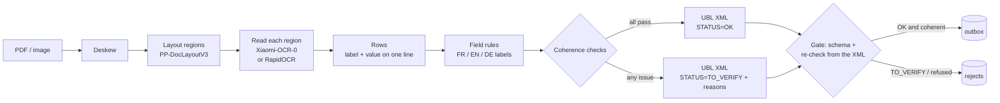

# invoice-ocr-local

Read scanned supplier invoices **entirely on your own machine** (no cloud API),
pull out the accounting fields, check that they add up, and write one
**UBL 2.1 / EN 16931** XML file per invoice — or set the invoice aside as
`TO_VERIFY` when something does not add up.

Inspired by a system I built for an accounting firm in Luxembourg. This repository
is a fresh, smaller rewrite: new code, and every invoice in it is invented.

## The problem

An accounting firm receives supplier invoices as PDFs and phone scans, in French,
English and German. Typing them into the accounting software is slow; sending them
to a cloud OCR service is not always acceptable for client data. A local pipeline
helps only if it is **safe**: a wrong amount that slips through silently is worse
than no automation at all. So the design goal is not only "read well" but
"**never export a wrong invoice as if it were right**".

## What the repository does



1. **Synthetic dataset** (`invoice_ocr/synth.py`): 40 deterministic invoices
   (seed 2026), FR / EN / DE, three layouts, 1 to 5 lines, the four Luxembourg VAT
   rates (17 / 14 / 8 / 3 %), VAT numbers for LU, BE, FR and DE that pass the official
   checksum rules. About half are degraded like a scan (rotation up to 2°, blur, noise,
   JPEG). Every page carries a `SAMPLE` watermark; the bank line is a placeholder, never
   an IBAN. Four invoices are wrong on purpose (total off by 10 €, a 20 % rate, a broken
   VAT number, a due date before the issue date) and must come out as `TO_VERIFY`.
   The ground truth (`data/truth.json`) records what each page *prints*.
2. **Reading**, three interchangeable engines (`invoice_ocr/engines/`):
   - `xiaomi`: the pair used by the real tool. **PP-DocLayoutV3** finds the regions,
     **Xiaomi-OCR-0** (a 0.8 B vision-language model) reads each region; tables come
     back as OTSL and are flattened. Ink that no region covers is read as well.
   - `rapidocr`: PP-OCR detection + the English PP-OCRv3 recogniser, in ONNX
     (~15 MB of weights, CPU). The light fallback.
   - `textlayer`: no OCR, the PDF text layer. Not an OCR engine: it measures the
     ceiling of the extraction rules when reading is perfect.
3. **Fields** (`extract.py`): label-then-value rules in three languages, tolerant of
   OCR that drops spaces (`Summenetto`, `MwSt.17%auf`). The rules never use arithmetic
   to guess or repair a value: arithmetic belongs to the checks.
4. **Checks** (`checks.py`): HT + VAT = TTC; the VAT breakdown adds up to the totals;
   each VAT amount equals base × rate; rates are Luxembourg rates; the VAT number passes
   its country checksum; issue date not in the future nor older than ~18 months; due
   date after the issue date and within 120 days; no required field missing.
5. **XML** (`ubl.py`, `schema/`): a header-level subset of a UBL 2.1 Invoice as used by
   EN 16931 / Peppol (ID, dates, supplier VAT number and name, VAT breakdown, totals),
   validated by an XSD shipped in the repo. The extraction status is mandatory and
   machine-readable in `cbc:Note` (`#AAI#STATUS=OK` or `#AAI#STATUS=TO_VERIFY;REASON,...`),
   and the schema itself refuses a `TO_VERIFY` without a reason.
6. **Gate** (`pipeline.gate`): before anything is written, the XML is validated, read
   back and checked again, independently of the code that chose the status. An `OK`
   on content that fails a check is refused.
7. **Watched folder** (`watch.py`): files dropped into `watch/inbox` are processed once
   their size is stable; `OK` goes to `watch/outbox` (XML + original), everything else
   to `watch/rejects` with a `.reasons.txt`.

## Results

Measured by `./run_benchmarks.sh --vlm` on a laptop (Intel i5-9300H, 8 threads,
GTX 1650 4 GB) that was running other jobs at the same time, so timings are pessimistic
and noisy. Generated numbers only:

<!-- results:start -->
| Run | Pages | Every field right | Reading errors caught | Silent errors (of which not the name) | Anomalies flagged | Time / page (median) |
|---|---|---|---|---|---|---|
| No OCR: PDF text layer — cpu | 40 | 100 % | 0/0 | 0 (0) | 4/4 | 4 ms |
| RapidOCR — cpu | 40 | 62 % | 0/12 | 12 (0) | 4/4 | 6.3 s |
| PP-DocLayoutV3 + Xiaomi-OCR-0 — cuda, NVIDIA GeForce GTX 1650 — first rules, before fixes | 40 | 65 % | 9/12 | 3 (3) | 4/4 | 52.8 s |
| PP-DocLayoutV3 + Xiaomi-OCR-0 — cuda, NVIDIA GeForce GTX 1650 | 40 | 100 % | 0/0 | 0 (0) | 4/4 | 52.8 s |

_Copied here by `python -m invoice_ocr report`; full tables in [results.md](results.md)._
<!-- results:end -->

"Reading errors caught" counts the normal invoices (the 4 deliberate anomalies are
counted apart) that have at least one wrong field and still did not leave as `OK`.
"Silent errors" are invoices exported `OK` with a wrong field: the number that matters
most. In brackets, those whose wrong field is one the checks are meant to protect (not
the supplier name, which no arithmetic can test). See [results.md](results.md) for
per-field accuracy, scanned pages only, and the list of every silent error.

### How much do the checks catch? Simulated misreads

The OCR engines rarely misread the digits of these clean pages, so real OCR errors
barely exercise the checks. `python -m invoice_ocr stress` starts from a perfect reading
and replaces one digit of one row (mostly typical OCR confusions such as 3/8 or 1/7),
1,800 times. Every misread that changed an amount, the VAT breakdown or the VAT number
was flagged; dates were flagged when the misread made them implausible (about 80 %);
the invoice number never is (nothing to check it against). Full table in
[results.md](results.md). Sums are checked to the cent, as in the EN 16931 rules
BR-CO-14 and BR-CO-15; a 0.01 tolerance first let a one-cent misread through.

### The guard, tested by mutation

`python -m tools.mutate` breaks the guarded code on purpose (switches off the totals
check, makes the status ignore the issues, makes the gate trust the declared status,
lets the export skip the gate, relaxes the schema), runs the test suite, expects it to
**fail**, then restores the file **from a backup copy** and expects it to pass again.
Each mutation turned at least one test red; the outcome is in [results.md](results.md).
Among the tests, `test_random_misreads_never_leave_as_ok` changes one digit of one
amount 300 times and asserts that an incoherent result is never exported `OK`.

## Run it

```bash
make setup            # Python 3.12 venv (PYTHON=python3.12) + light dependencies (CPU)
make data             # 40 invoices in data/ (about a minute)
make test             # 43 unit tests, no model needed
python -m invoice_ocr process data/images/INV-02.png --engine rapidocr --xml
make bench            # textlayer + RapidOCR + mutation test -> results.md

make setup-vlm        # optional: torch + transformers (CUDA 11.8 build)
make bench-vlm        # + Xiaomi-OCR-0 on GPU (40 pages) and CPU (3 pages)

make watch            # watched folder: drop files into watch/inbox
```

`.venv/bin/python` is assumed by the Makefile. Model weights are downloaded from
Hugging Face on first use, at pinned revisions; nothing else leaves the machine.

## Choices and honest limits

- **Models.** The real tool's pair (PP-DocLayoutV3 + Xiaomi-OCR-0) runs here, on the
  GPU in fp16. Without the optional `flash-linear-attention` / `causal-conv1d` kernels,
  Transformers falls back to its reference implementation of the model's linear
  attention, which is slow; on CPU a page takes minutes, so the CPU figure is measured
  on 3 pages only (about 50 s per page on the GPU, measured). RapidOCR is the practical
  CPU option. Tesseract was not used: it is
  not installed on the build machine and needs a system package.
- **The rules were tuned on the test set.** There is no held-out set. After the first
  Xiaomi-OCR-0 run, three formatting quirks of its output were handled (a value in a
  table cell after `|`, a space inside `30. 06.2026` and `4. 854,80`), and the same OCR
  output was rescored. Both scorings are reported: before the fixes, 3 invoices left
  `OK` with a wrong invoice number (the street number "77" read as the number), which
  no arithmetic check can catch; after, 40/40. Read the 100 % as "the pipeline can be
  made to fit these templates", not as expected accuracy.
- **What RapidOCR gets wrong** here is almost only "S.à r.l." read as "S.a r.I.": every
  amount, date, VAT number and invoice number was right, and every name error left as
  `OK`. Supplier names are the weak spot of the checks (see below).
- **Synthetic data is easier than real mail.** Three layouts, one page, clean fonts,
  printed totals. Real invoices have many more layouts, multi-page documents, credit
  notes, handwriting and stamps. The numbers here say the pipeline works end to end and
  measure its safety net; they do not predict accuracy on a real mailbox.
- **What the checks cannot see.** A misread supplier name or a plausible but wrong date
  passes every arithmetic check. In practice the supplier is matched against the
  accounting software's supplier list by VAT number; that lookup is not part of this repo.
- **XML subset.** Header fields only: no invoice lines, no customer party, no
  addresses, so the output is not a complete Peppol BIS Billing 3.0 document. The
  element names, namespaces and order follow UBL 2.1, so it can be completed into one.
  The XSD is a hand-written subset, not the official OASIS schema.
- **VAT numbers** are random numbers that satisfy the published checksum rules; any
  match with a real registration is a coincidence. No VIES lookup is made.
- **Extraction is rule-based.** It is transparent and fast, and it was tuned on these
  templates. An optional LLM extraction step would generalise better; it is not included.

## Layout

```
invoice_ocr/
  synth.py        fictitious invoices + ground truth
  pages.py        PDF/image loading, deskew
  engines/        textlayer, rapidocr, xiaomi (layout + VLM), shared row merging
  extract.py      FR/EN/DE field rules
  checks.py       coherence checks
  ubl.py          UBL subset writer / reader, XSD validation
  schema/         the XSD subset (Invoice, cac, cbc)
  pipeline.py     process one file, the gate, export routing
  watch.py        watched-folder mode
  evaluate.py     one engine over the dataset -> results/<run>.json
  report.py       results/*.json -> results.md (and the table above)
tools/mutate.py   mutation test of the guard
tests/            unit tests (pytest)
```
