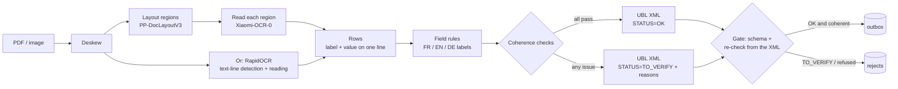

# invoice-ocr-local

[](https://github.com/NilsDavoine/invoice-ocr-local/actions/workflows/tests.yml)

Read scanned supplier invoices **entirely on your own machine** (no cloud API),
pull out the accounting fields, check that they add up, and write one
**UBL 2.1 / EN 16931** XML file per invoice — or set the invoice aside as
`TO_VERIFY` when something does not add up.

## How this was built

This is a public reconstruction of a system I designed and run in production for an
accounting firm in Luxembourg, which reads supplier invoices on a local workstation.
The production code and data stay private, so this version runs on invented data. I
built it with Claude Code as a coding agent: I set the architecture, the measurements
and the acceptance criteria, and the agent wrote most of the code to that brief. Every
number in `results.md` is regenerated by a script, and each guardrail is tested by
breaking it on purpose.

## The problem

An accounting firm receives supplier invoices as PDFs and phone scans, in French,
English and German. Typing them into the accounting software is slow; sending them
to a cloud OCR service is not always acceptable for client data. A local pipeline
helps only if it is **safe**: a wrong amount that slips through silently is worse
than no automation at all. So the design goal is not only "read well" but
"**never export a wrong invoice as if it were right**".

## What the repository does



1. **Synthetic dataset** (`invoice_ocr/synth.py`): 40 deterministic invoices
   (seed 2026), FR / EN / DE, three layouts, 1 to 5 lines, the four Luxembourg VAT
   rates (17 / 14 / 8 / 3 %), VAT numbers for LU, BE, FR and DE that pass the official
   checksum rules. About half are degraded like a scan (rotation up to 2°, blur, noise,
   JPEG). Every page carries a `SAMPLE` watermark; the bank line is a placeholder, never
   an IBAN. Four invoices are wrong on purpose (total off by 10 €, a 20 % rate, a broken
   VAT number, a due date before the issue date) and must come out as `TO_VERIFY`.
   The ground truth (`data/truth.json`) records what each page *prints*.
   This is the **tuning set**: the extraction rules were written and adjusted on it.
   A separate **held-out test set** (`generate --holdout`, seed 7351, 30 invoices) was
   written after the rules were frozen and never used to change them: six new
   suppliers, new invoice number formats, the same share of scans, 3 deliberate
   anomalies, and a fourth layout **D** the rules never saw (metadata as a grid with
   the labels on one line and the values below, supplier VAT number only in the footer).
   Each run stores a hash of the rule files, so `results.md` shows that the tuning and
   held-out runs used the same rules.
2. **Reading**, three interchangeable engines (`invoice_ocr/engines/`):
   - `xiaomi`: the pair used by the real tool. **PP-DocLayoutV3** finds the regions,
     **Xiaomi-OCR-0** (a 0.8 B vision-language model) reads each region; tables come
     back as OTSL and are flattened. Ink that no region covers is read as well.
   - `rapidocr`: PP-OCR detection + the English PP-OCRv3 recogniser, in ONNX
     (~15 MB of weights, CPU). The light fallback.
   - `textlayer`: no OCR, the PDF text layer. Not an OCR engine: it measures the
     ceiling of the extraction rules when reading is perfect.
3. **Fields** (`extract.py`): label-then-value rules in three languages, tolerant of
   OCR that drops spaces (`Summenetto`, `MwSt.17%auf`). The rules never use arithmetic
   to guess or repair a value: arithmetic belongs to the checks.
4. **Checks** (`checks.py`): HT + VAT = TTC; the VAT breakdown adds up to the totals;
   each VAT amount equals base × rate; rates are Luxembourg rates; the VAT number passes
   its country checksum; issue date not in the future nor older than ~18 months; due
   date after the issue date and within 120 days; no required field missing.
5. **XML** (`ubl.py`, `schema/`): a header-level subset of a UBL 2.1 Invoice as used by
   EN 16931 / Peppol (ID, dates, supplier VAT number and name, VAT breakdown, totals),
   validated by an XSD shipped in the repo. The extraction status is mandatory and
   machine-readable in `cbc:Note` (`#AAI#STATUS=OK` or `#AAI#STATUS=TO_VERIFY;REASON,...`),
   and the schema itself refuses a `TO_VERIFY` without a reason.
6. **Gate** (`pipeline.gate`): before anything is written, the XML is validated, read
   back and checked again, independently of the code that chose the status. An `OK`
   on content that fails a check is refused.
7. **Watched folder** (`watch.py`): files dropped into `watch/inbox` are processed once
   their size is stable; `OK` goes to `watch/outbox` (XML + original), everything else
   to `watch/rejects` with a `.reasons.txt`.

## Results

Measured by `./run_benchmarks.sh --vlm` on a laptop (Intel i5-9300H, 8 threads,
GTX 1650 4 GB) that was running other jobs at the same time, so timings are pessimistic
and noisy. Each engine is scored on the tuning set (40 invoices, the rules were adjusted
on it) and on the held-out set (30 invoices, never seen while writing the rules).
Generated numbers only:

<!-- results:start -->
| Engine | Every field right: tuning set | held-out set | Silent errors (of which not the name): tuning | held-out | Anomalies flagged: tuning | held-out | Time / page (median) |
|---|---|---|---|---|---|---|---|
| No OCR: PDF text layer — cpu | 100 % | 67 % | 0 (0) | 0 (0) | 4/4 | 3/3 | 4 ms |
| RapidOCR — cpu | 62 % | 67 % | 12 (0) | 0 (0) | 4/4 | 3/3 | 6.3 s |
| PP-DocLayoutV3 + Xiaomi-OCR-0 — cuda, NVIDIA GeForce GTX 1650 | 100 % | 63 % | 0 (0) | 0 (0) | 4/4 | 3/3 | 52.8 s |
| PP-DocLayoutV3 + Xiaomi-OCR-0 — cpu, 3 pages | 100 % | - | 0 (0) | - | 0/0 | - | 535.1 s |

_Copied here by `python -m invoice_ocr report`; full tables in [results.md](results.md)._
<!-- results:end -->

"Reading errors caught" counts the normal invoices (the 4 deliberate anomalies are
counted apart) that have at least one wrong field and still did not leave as `OK`.
"Silent errors" are invoices exported `OK` with a wrong field: the number that matters
most. In brackets, those whose wrong field is one the checks are meant to protect (not
the supplier name, which no arithmetic can test). See [results.md](results.md) for
per-field accuracy, scanned pages only, and the list of every silent error.

### How much do the checks catch? Simulated misreads

The OCR engines rarely misread the digits of these clean pages, so real OCR errors
barely exercise the checks. `python -m invoice_ocr stress` starts from a perfect reading
and replaces one digit of one row (mostly typical OCR confusions such as 3/8 or 1/7),
1,800 times. Every misread that changed an amount, the VAT breakdown or the VAT number
was flagged; dates were flagged when the misread made them implausible (about 80 %);
the invoice number never is (nothing to check it against). Full table in
[results.md](results.md). Sums are checked to the cent, as in the EN 16931 rules
BR-CO-14 and BR-CO-15; a 0.01 tolerance first let a one-cent misread through.

### The guard, tested by mutation

`python -m tools.mutate` breaks the guarded code on purpose (switches off the totals
check, makes the status ignore the issues, makes the gate trust the declared status,
lets the export skip the gate, relaxes the schema), runs the test suite, expects it to
**fail**, then restores the file **from a backup copy** and expects it to pass again.
Each mutation turned at least one test red; the outcome is in [results.md](results.md).
Among the tests, `test_random_misreads_never_leave_as_ok` changes one digit of one
amount 300 times and asserts that an incoherent result is never exported `OK`.

## Run it

```bash
make setup            # Python 3.12 venv (PYTHON=python3.12) + light dependencies (CPU)
make data             # 40 tuning invoices in data/, 30 held-out in data_holdout/
make test             # 48 unit tests; one runs RapidOCR (~15 MB), none needs the VLM
python -m invoice_ocr process data/images/INV-02.png --engine rapidocr --xml
make bench            # textlayer + RapidOCR on both sets + mutation test -> results.md

make setup-vlm        # optional: torch + transformers (CUDA 11.8 build)
make bench-vlm        # + Xiaomi-OCR-0 on GPU (40 + 30 pages) and CPU (3 pages, 40 min cap)

make watch            # watched folder: drop files into watch/inbox
```

`.venv/bin/python` is assumed by the Makefile. Model weights are downloaded from
Hugging Face on first use, at pinned revisions; nothing else leaves the machine.

## Choices and honest limits

- **Models.** The real tool's pair (PP-DocLayoutV3 + Xiaomi-OCR-0) runs here, on the
  GPU in fp16. Without the optional `flash-linear-attention` / `causal-conv1d` kernels,
  Transformers falls back to its reference implementation of the model's linear
  attention, which is slow: about 50 s per page on the GPU (measured, 40 + 30 pages).
  On the CPU alone (bf16, 4 threads, measured on 3 pages only) it takes about
  **9 minutes per page** (437 to 628 s), with every field right on the 3 pages. That is
  usable for a nightly batch, not for a person waiting. RapidOCR reads a page in about
  6 s on the same CPU.
  Tesseract was not used: it is not installed on the build machine and needs a system
  package.
- **Tuning set and held-out set.** On the tuning set, after the first Xiaomi-OCR-0 run,
  three formatting quirks of its output were handled (a value in a table cell after `|`,
  a space inside `30. 06.2026` and `4. 854,80`), and the same OCR output was rescored.
  Both scorings are in [results.md](results.md): before the fixes, 3 invoices left `OK`
  with a wrong invoice number (the street number "77" read as the number); after, 40/40.
  That 100 % only says the rules can be made to fit the templates they were tuned on.
  On the held-out set, with the rules frozen, every field was right on 20 of 30
  invoices with the text layer, 20 with RapidOCR and 19 with Xiaomi-OCR-0. The misses
  are all 10 pages of the unseen layout D for every engine (the grid with labels above
  values defeats label-then-value rules), plus one Xiaomi-OCR-0 page whose VAT summary
  was not read. No engine exported a wrong invoice as `OK`, and the 3 deliberate
  anomalies were flagged. On layout D, the check that stopped the pages was the one for
  missing fields (no invoice number, no issue date found). On 8 of 10 of those pages the
  rules had also taken the issue date for the due date, a wrong value that the date
  checks would not have stopped on their own (a due date equal to the issue date is
  allowed). So
  on a layout it has never seen, the pipeline stays safe but does not read the invoice.
  A new supplier layout needs new rules, or an LLM extraction step.
- **What RapidOCR gets wrong** here is almost only "S.à r.l." read as "S.a r.I.": every
  amount, date, VAT number and invoice number was right, and every name error left as
  `OK`. Supplier names are the weak spot of the checks (see below).
- **Synthetic data is easier than real mail.** Three layouts, one page, clean fonts,
  printed totals. Real invoices have many more layouts, multi-page documents, credit
  notes, handwriting and stamps. The numbers here say the pipeline works end to end and
  measure its safety net; they do not predict accuracy on a real mailbox.
- **What the checks cannot see.** A misread supplier name or a plausible but wrong date
  passes every arithmetic check. In practice the supplier is matched against the
  accounting software's supplier list by VAT number; that lookup is not part of this repo.
- **XML subset.** Header fields only: no invoice lines, no customer party, no
  addresses, so the output is not a complete Peppol BIS Billing 3.0 document. The
  element names, namespaces and order follow UBL 2.1, so it can be completed into one.
  The XSD is a hand-written subset, not the official OASIS schema.
- **VAT numbers** are random numbers that satisfy the published checksum rules; any
  match with a real registration is a coincidence. No VIES lookup is made.
- **Extraction is rule-based.** It is transparent and fast, and it was tuned on these
  templates. An optional LLM extraction step would generalise better; it is not included.

## Layout

```
invoice_ocr/
  synth.py        fictitious invoices + ground truth
  pages.py        PDF/image loading, deskew
  engines/        textlayer, rapidocr, xiaomi (layout + VLM), shared row merging
  extract.py      FR/EN/DE field rules
  checks.py       coherence checks
  ubl.py          UBL subset writer / reader, XSD validation
  schema/         the XSD subset (Invoice, cac, cbc)
  pipeline.py     process one file, the gate, export routing
  watch.py        watched-folder mode
  evaluate.py     one engine over the dataset -> results/<run>.json
  report.py       results/*.json -> results.md (and the table above)
tools/mutate.py   mutation test of the guard
tests/            unit tests (pytest), run by GitHub Actions on every push
```

## License

MIT, see [LICENSE](LICENSE). Third-party models keep their own licenses.
